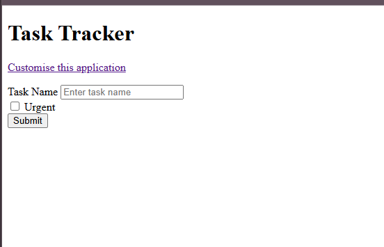
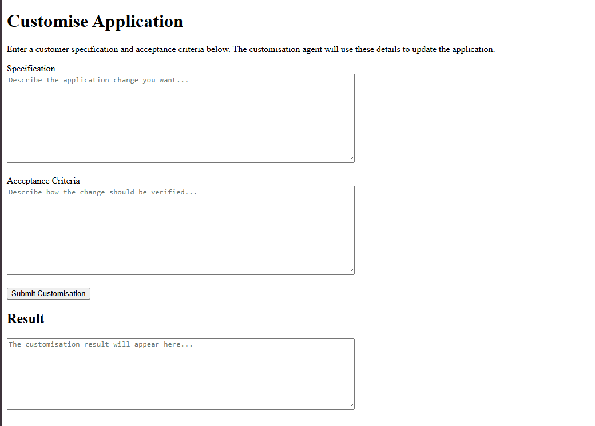

# User Guide

## Overview

CustomisationAgent is a small Task Tracker application with a built-in customisation screen.

As a user you can:

1. Create tasks using the Task Tracker screen.
2. Ask for a change to the application by describing it in plain English on the Customise Application screen.

When you submit a customisation request, an AI agent reads the application's code and prepares the changes you asked for. It does not change the running application directly. Instead it puts the proposed changes, with a markdown document explaining them, in a `review` folder so that a developer can check them before they are applied.

## Before You Start

The application must be running, and Ollama must be running with the configured model (`qwen3:8b` by default) available. See the [README](../README.md) for setup and start-up instructions.

Once started, the application is available at:

    http://localhost:8080

## Task Tracker Screen

Open:

    http://localhost:8080/index.html

This is the main screen of the application. It contains:

| Element | Description |
|---------|-------------|
| **Customise this application** | A link to the Customise Application screen. |
| **Task Name** | A text box for the name of the task. This field is required. |
| **Urgent** | A checkbox. Tick it to mark the task as urgent. |
| **Submit** | Saves the task. |

### Creating a Task

1. Type a name into the **Task Name** box, for example `Buy server space`.
2. Tick **Urgent** if the task is urgent.
3. Click **Submit**.

If the task is saved, a **Task Created Successfully** section appears below the form showing:

- **ID** - the number given to the new task
- **Task Name** - the name you entered
- **Urgent** - `Yes` or `No`

If the task cannot be saved, the message `Failed to create task` is shown. If the application cannot be reached, a message starting with `Error:` is shown instead.

Tasks are kept in an in-memory database, so they are lost when the application is restarted.

## Customise Application Screen

Open it by clicking **Customise this application** on the Task Tracker screen, or go to:

    http://localhost:8080/customise.html

This screen lets you describe a change you want made to the application. It contains:

| Element | Description |
|---------|-------------|
| **Specification** | Describe the change you want. This field is required. |
| **Acceptance Criteria** | Describe how to check that the change is correct. This field is required. |
| **Submit Customisation** | Sends your request to the customisation agent. |
| **Result** | A read-only box showing the outcome of your request. |

### Submitting a Customisation Request

1. Enter your **Specification**.
2. Enter your **Acceptance Criteria**.
3. Click **Submit Customisation**.

The Result box shows `Submitting customisation request...` and the **Submit Customisation** button is disabled while the agent works. This can take several minutes, because the AI model reads and writes several files before it finishes. Keep the page open until the result appears.

### Understanding the Result

| Result | Meaning |
|--------|---------|
| Starts with `CUSTOMISATION_COMPLETED` | The agent finished and the proposed changes are in the `review` folder. A short summary of what was done follows. |
| `Customisation request failed. ERROR: AI customisation completed without writing any files to the review folder.` | The agent finished without preparing any changes. Try again, or reword the request to be more specific. |
| `Customisation request failed. ERROR: AI customisation execution failed: ...` | Something went wrong while the agent was running, for example Ollama was not available. The rest of the message gives the reason. |
| Starts with `Error submitting customisation request.` | The browser could not reach the application. Check it is still running. |

A completed customisation does **not** change the Task Tracker screen straight away. The changes only take effect after a developer has reviewed them and copied them into the application (see [After a Customisation Completes](#after-a-customisation-completes)).

## Writing a Good Request

The agent works best with clear, specific requests.

**Specification** - say what should change and where. Mention:

- the new information or behaviour you want
- whether a field is required or optional
- where it should appear on the screen
- whether it should be saved and returned with the task

**Acceptance Criteria** - say how someone can tell the change works. The `GIVEN / WHEN / THEN` style works well.

Keep each request to a single change. Several unrelated changes in one request are more likely to fail.

### Example

Specification:

    Add support for a task description.

    Users should be able to enter a description when creating a task. The description should be optional and allow longer free-text content than the task name.

    The task description must be stored in the database with the task and returned by the task API when tasks are created, listed, or retrieved by ID.

    The task creation screen should include a Task Description text area. When the user submits the form, the description should be sent to the task creation API along with the task name and urgent flag.

Acceptance Criteria:

    GIVEN I am on the task creation screen
    WHEN I view the task creation form
    THEN I should see a Task Description text area.

    GIVEN I am on the task creation screen
    WHEN I enter a task name, enter a task description, optionally tick Urgent, and submit the form
    THEN the task should be created successfully
    AND the task description should be saved with the task.

## After a Customisation Completes

The proposed changes are placed in the `review` folder in the project, which mirrors the layout of the application, for example:

    review
      DOCUMENTATION.md
      src/main/java/com/reedmanit/CustomisationAgent/task/Task.java
      src/main/resources/static/index.html

To apply the changes:

1. Read `review/DOCUMENTATION.md`, which explains what was changed and why.
2. Check the changed files in the `review` folder.
3. Copy the approved files from `review` into `src`.
4. Run the tests and restart the application.
5. Open the Task Tracker screen to see the change.

**Important:** the `review` folder is emptied at the start of every customisation request. Apply or save any changes you want to keep before submitting another request.

## Things to Be Aware Of

- Only one request should be submitted at a time. Wait for the result before submitting another.
- The AI model can make mistakes. Always review the proposed changes before applying them.
- The application is intended for local development and experimentation. It has no login and should not be made available publicly.

## Related Documentation

- [README](../README.md) - setup, running the application and the APIs
- [CustomisationAgentService](CustomisationAgentService.md) - how the customisation agent works
- [CustomisationController](CustomisationController.md) - the customisation REST API
- [CustomisationTools](CustomisationTools.md) - the tools the agent uses to read and write files
